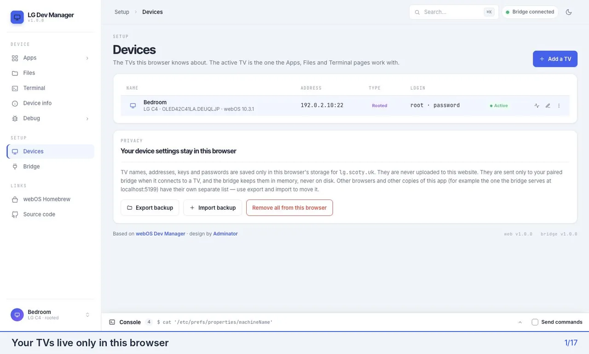
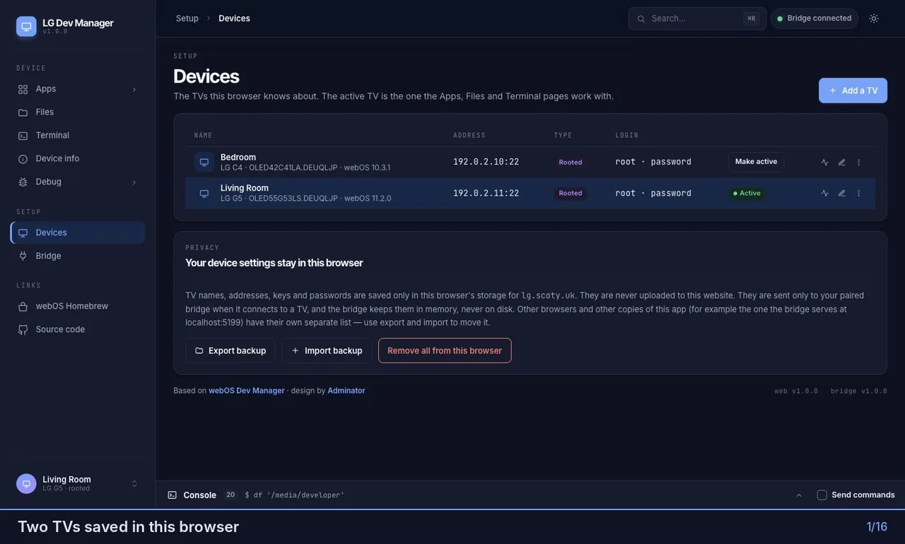

# LG Dev Manager

Manage LG webOS TVs from your browser — rooted (Homebrew Channel) or in Developer Mode. From your computer, or from any
computer, phone or tablet at home with the bridge on a NAS or home server.

- **Apps:** install and update apps from the webOS Homebrew repository, from [custom repositories](#custom-repositories)
  you add (the same ones Homebrew Channel takes), or from an IPK file — and any build of
  [Litefin](#litefin-in-one-click) in one click.
- **Files and shell:** browse, upload and download the TV's files, and open a terminal.
- **The TV itself:** model and firmware, screenshots, Homebrew Channel updates and the Developer Mode session.
- **Debug:** live system and kernel logs, log levels, crash reports and the luna bus monitor.
- **Your TVs, wherever you are:** saved in your browser, or on the bridge so every browser you pair sees the same TVs.

A web rebuild of [webosbrew/dev-manager-desktop](https://github.com/webosbrew/dev-manager-desktop), styled after
[Adminator](https://github.com/puikinsh/adminator-admin-dashboard).

> **Note:** LG Dev Manager is an independent, community project. It is not affiliated with, endorsed by or supported
> by LG Electronics. LG and webOS are trademarks of LG Electronics. Rooting a TV or using Developer Mode is at your own
> risk.

### Add a TV, install an app and update it



### Debug tools on a rooted TV



## Get started

The app runs in your browser and needs a small helper, **the bridge**, that talks to your TVs (why:
[How it works](#how-it-works)). It's the same bridge every way you run it — pick the one that suits you:

| | Runs on | Needs | Use it from |
|---|---|---|---|
| [**1. The app**](#app) | your computer (Windows, macOS, Linux) | nothing | that computer |
| [**2. npx**](#npx) | your computer | Node.js 22.12+ | that computer |
| [**3. Docker**](#docker) | a NAS or home server (Linux) | Docker | every computer, phone and tablet on your network |
| [**4. From the source code**](#run-from-source) | your computer | Node.js 22.12+, git | that computer |

Then [pair your browser and add a TV](#pair).

<a id="app"></a>

## Way 1: the app — no Node.js needed

One file with everything inside. Download the one for your computer from the
[latest release](https://github.com/Scoty/lg-dev-manager/releases/latest):

| Computer | File |
|---|---|
| Windows | `lg-dev-manager-bridge-<version>-windows-x64.exe` — just run it (also works on Windows on ARM) |
| Mac with Apple Silicon (M1 and newer) | `…-macos-arm64.dmg` — open it, then double-click `lg-dev-manager-bridge` |
| Mac with Intel | `…-macos-x64.dmg` |
| Linux (x64 / ARM64) | `…-linux-x64.tar.gz` / `…-linux-arm64.tar.gz` — `tar -xzf …`, then `./lg-dev-manager-bridge` |

A window opens with the **pairing token** and a pairing link. On Windows and macOS, https://lg.scoty.uk also opens in
your browser, ready to pair with one click. Keep the window open while you use the app; closing it stops the bridge.
Then [pair and add a TV](#pair).

> **The first time:** the app isn't signed by Apple or Microsoft (that costs a yearly fee), so your computer asks
> before running it. **Windows**: "Windows protected your PC" → **More info** → **Run anyway**. **macOS**: "Apple
> could not verify…" → **Done**, then **System Settings → Privacy & Security** → **Open Anyway**. You only do this
> once. It's the same code as the npm package, built and tested by GitHub Actions in public. Each release lists
> SHA-256 checksums.

<a id="npx"></a>

## Way 2: npx

**You need [Node.js](https://nodejs.org) 22.12 or newer** (any current LTS — 22 or 24). `node --version` shows
yours. In a terminal:

```bash
npx lg-dev-manager-bridge@latest
```

It prints a **pairing token**, a pairing link and both addresses of the app. Keep the terminal open while you use the
app (Ctrl+C stops it). Then [pair and add a TV](#pair).

To use it from your other devices too, share it on your network — the same as [Docker](#docker) does, on any computer
that stays on, with that computer's name or IP as the address:
`npx lg-dev-manager-bridge@latest --listen 0.0.0.0 --public-url http://nasname.local:5199 --store`.

<a id="docker"></a>

## Way 3: on a NAS or home server (Docker)

Run the bridge once on a NAS or home server and use LG Dev Manager from every computer, phone and tablet on your
network — nothing to install anywhere else. The Docker image (`ghcr.io/scoty/lg-dev-manager`, Linux on amd64 or arm64)
serves the app itself, at the address you give it, and keeps your TVs for everyone:

- **One list of TVs for every browser.** The container stores your TVs — with their logins — the custom repositories
  and the screenshots in `/data`, so every browser and phone you pair sees the same ones, and changes show up
  everywhere at once. A TV's password or key goes to the bridge once and is never sent back to any browser, and the
  bridge only sends it to that TV (it checks the TV's SSH host key first). TVs you saved in a browser before can be
  moved there from the Devices page.
- **Paired with a link.** The container's log shows a pairing link for each address; open it in each browser that
  should use it and click **Pair**.
- **Phones and tablets** get pages that fit their screen and a terminal with the keys a phone keyboard lacks.

### Any Linux server

Save [`compose.yaml`](compose.yaml) on the server, set `LGDM_PUBLIC_URL` in it to the address (or addresses,
comma-separated) you'll open it at, then:

```bash
docker compose up -d
docker compose logs lg-dev-manager    # shows the pairing links
```

To update: `docker compose pull && docker compose up -d`. Your pairing and TVs stay as they are.

### Example: a Ugreen NAS

On a Ugreen NAS (UGOS Pro, e.g. the DXP2800), with the address you open it at being either the NAS's name or its IP:

1. In the **Files** app, create the folder `lg-dev-manager` in the `docker` shared folder (`/volume1/docker/lg-dev-manager`).
2. In the **Docker** app, open **Project → Create** (or create a stack in Dockhand or Portainer) and paste
   [`examples/ugreen-nas/compose.yaml`](examples/ugreen-nas/compose.yaml):

   ```yaml
   services:
     lg-dev-manager:
       image: ghcr.io/scoty/lg-dev-manager:2
       container_name: lg-dev-manager
       network_mode: host
       environment:
         # The addresses you open it at, separated by commas: the NAS's name and its IP address.
         LGDM_PUBLIC_URL: http://nasname.local:5199,http://192.0.2.10:5199
       volumes:
         - /volume1/docker/lg-dev-manager:/data
       restart: unless-stopped
       read_only: true
       cap_drop: [ALL]
       security_opt: [no-new-privileges:true]
   ```

3. Replace `nasname.local` and `192.0.2.10` with your NAS's name and IP address (your router's list of devices shows
   both; a fixed IP for the NAS helps).
4. Start it and open its log: it shows a pairing link for each address, e.g.
   `http://nasname.local:5199/#/pair?token=…`. Open one in each browser that should use the app.

If the log says the bridge can't write to `/data`, the folder isn't writable by the container's user (1000): over SSH,
`sudo chown 1000:1000 /volume1/docker/lg-dev-manager`, or set `user:` to your own ids (the example file explains). To
update, pull the image again and recreate the project (in Dockhand or Portainer: pull and redeploy the stack).

### Keep it on your network

> ⚠️ **Don't make it reachable from the internet** — the one exception is [Cloudflare Access](#cloudflare-access),
> below, and only if you set it up as described. It controls your TVs: don't forward its port on your router, and don't
> put a tunnel, a reverse proxy with a public hostname or any other relay in front of it — if your server runs
> cloudflared or Nginx Proxy Manager for other apps, leave this one out. It only answers devices on your local network,
> and it uses plain HTTP — for encryption, put it behind your own HTTPS reverse proxy on your network and use the
> proxy's `https://` address as `LGDM_PUBLIC_URL`.

It uses host networking (`network_mode: host`), so the TV scan sees your network and the bridge sees who connects.
Behind a reverse proxy, every browser arrives from the proxy's address, so they share one limit on wrong pairing tokens:
a few wrong tries from any of them make all of them wait a while (up to 15 minutes), and at most 8 of them can be
waiting to pair at the same moment (the same goes for the devices of one IPv6 network).
https://lg.scoty.uk can't use a bridge on another machine (browsers don't let an https page connect to it), so the
bridge doesn't accept it in this mode: use the page the container serves. Settings, all optional except the first:

| Variable | |
|---|---|
| `LGDM_PUBLIC_URL` | The addresses you open it at, comma-separated, e.g. `http://nasname.local:5199,http://192.0.2.10:5199`. Requests for any other address are refused |
| `LGDM_PORT` | Another port than 5199 |
| `LGDM_STORE` | `0` keeps the TVs in each browser instead of on the server |
| `LGDM_ALLOWED_NETWORKS` | Also let in devices on networks that aren't a private range, e.g. global IPv6 from another subnet: `2001:db8::/56` |
| `LGDM_TOKEN` | Your own pairing token (16+ characters); otherwise a random one is made and kept in `/data` |
| `LGDM_CF_ACCESS_TEAM`, `LGDM_CF_ACCESS_AUD`, `LGDM_CF_ACCESS_ALLOW` | Reaching it from outside through Cloudflare Access: [see below](#cloudflare-access) |

No Docker? The same works with [npx](#npx) on any computer that stays on.

<a id="cloudflare-access"></a>

### From outside your home: Cloudflare Access (advanced — use with caution)

You can reach the bridge from anywhere through a **Cloudflare Tunnel protected by Cloudflare Access**, so you sign in
with Cloudflare first — with Google (and its two-step verification), a one-time PIN, the WARP client, or a service
token's `CF-Access-Client-Id` / `CF-Access-Client-Secret` headers.

> ⚠️ **LG Dev Manager has no login of its own** — no user accounts, passwords or two-factor sign-in. Apart from the
> pairing token (one shared secret), **Cloudflare Access is the only thing that keeps others away from your TVs**, and
> whoever gets past it with the token can do anything on them (on a rooted TV, as root). Only set this up if you need
> it, keep the Access policy to your own accounts, and use it with caution.

The bridge doesn't rely on Cloudflare's settings alone. Without the settings below it refuses everything that comes
through Cloudflare. With them, every request through Cloudflare must carry the token Access signs for the person it let
in: for your team, for this application, not expired, and for one of the people in `LGDM_CF_ACCESS_ALLOW`. So a
hostname without an Access application, a "Bypass" or "Everyone" policy, or a sign-in by someone not on your list gets
nothing — and a request for the Cloudflare hostname needs that token even if it arrives without Cloudflare's headers.
Only that hostname's own page may connect through Access, and each connection lasts at most an hour (or until the Access
session ends); the page then reconnects through Cloudflare, which checks your sign-in again.

1. **Access application.** In Cloudflare Zero Trust → **Access → Applications**, add a **Self-hosted** application for
   a hostname such as `tv.example.com`. Give it an **Allow** policy that includes only your own email addresses (or
   your service token) — not "Everyone" or a whole email domain — with a login that has two-factor (e.g. Google with
   2-step verification), and a short session (24 hours or less). Under the application's cookie settings, turn on
   **HTTP Only**, **Binding Cookie** and **SameSite: Strict**. Copy the application's **Audience (AUD) tag**.
2. **Tunnel.** Add a public hostname for `tv.example.com` to your tunnel, with the service
   `http://localhost:5199` (cloudflared on the same server, with host networking) or `http://192.0.2.10:5199` (the
   server's IP). In the hostname's additional application settings, also turn on **Access → Protect with Access**
   (cloudflared's `access: required`) with the same team and audience tag, so cloudflared checks the sign-in too.
3. **Settings.** Add the hostname to `LGDM_PUBLIC_URL` and the Access settings to the container's environment. With
   Access on, every `https://` address in `LGDM_PUBLIC_URL` counts as a Cloudflare hostname and needs an Access
   sign-in, so don't also list an HTTPS reverse proxy on your network there:

   ```yaml
       environment:
         LGDM_PUBLIC_URL: http://nasname.local:5199,http://192.0.2.10:5199,https://tv.example.com
         LGDM_CF_ACCESS_TEAM: yourteam              # from yourteam.cloudflareaccess.com
         LGDM_CF_ACCESS_AUD: <the application's audience tag>
         LGDM_CF_ACCESS_ALLOW: you@gmail.com        # emails and/or service-token client ids (….access), comma-separated
   ```

4. **Pair.** Open `https://tv.example.com`, sign in with Cloudflare, and paste the pairing token on the **Bridge** page.
   The log has no pairing link for this address on purpose: Cloudflare's sign-in would carry the token through its own
   and your identity provider's pages.

Before you rely on it:

- **Cloudflare sees the traffic.** It decrypts it at its edge, so it can see the pairing token, what you type in the
  terminal and — when TVs are kept in the browser — the TV passwords and keys sent with each request. With the Docker
  image's default (TVs stored on the server), a TV's login only travels when you add it or change it.
- **Your Cloudflare sign-in is now the key to your TVs.** Protect that account with two-factor, sign out on shared
  devices, and revoke sessions in Zero Trust if a device is lost (a stolen session works until it expires). Prefer SSH
  keys over passwords for your TVs.
- **So is your Cloudflare account.** Whoever controls your Zero Trust settings can add a sign-in method that claims any
  email: protect the Cloudflare account itself with strong two-factor.
- **It reaches more than your TVs.** The bridge can connect to devices on your home network (that's how it finds and
  adds TVs), so getting past Access and the token is a way into your network, not just your TVs.
- **WARP private networks count as your local network.** If you route your home network through Cloudflare WARP
  (private network routing, WARP Connector), devices on it are let in like ones at home, without the Access check or
  `LGDM_CF_ACCESS_ALLOW`.
- **Keep the pairing token to yourself.** To change it, stop the container, delete `bridge.json` from its data folder
  and start it again (every browser has to pair again).
- **Tunnel only.** Don't also forward the port on your router.

<a id="run-from-source"></a>

## Way 4: from the source code

Run it from a clone. It's the same bridge, and it serves the local page (http://localhost:5199) too:

```bash
git clone https://github.com/Scoty/lg-dev-manager.git
cd lg-dev-manager
corepack enable      # once, to get pnpm
pnpm install
pnpm build
pnpm bridge          # same as: node apps/bridge/dist/cli.js
```

This needs Node.js 22.12 or newer, the same as npx (the project itself is developed on Node 24, see `.nvmrc`).
To update: `git pull`, `pnpm install`, `pnpm build`, then `pnpm bridge`.

It prints the pairing token and a pairing link; then [pair and add a TV](#pair).

<a id="pair"></a>

## Pair and add a TV

1. **Open the app.** With the bridge on your computer, open its local page, **http://localhost:5199**, or
   **https://lg.scoty.uk** — the same app. With [Docker](#docker), open the address you gave it.
2. **Pair.** Open the pairing link the bridge printed (or paste the pairing token on the **Bridge** page). Each
   browser pairs once.
3. **Add your TV.** On **Devices → Add a TV**, pick it from the scan. Rooted TVs log in as root (Homebrew Channel's SSH
   server); other TVs use the Developer Mode app and its passphrase.

On macOS, the first time the bridge looks for your TV, the system asks whether your terminal may find devices on the
local network — choose **Allow**. Phones and tablets can't run the bridge; to use the app on them, run it on a NAS or
home server ([Docker](#docker)) and open the page it serves.

**Which page, with the bridge on your computer:**

1. **http://localhost:5199**, the local page, is served by the bridge itself. It always matches your bridge's version,
   and it works offline and even when the website can't be reached.
2. **https://lg.scoty.uk** always has the latest version of the app and needs nothing installed besides the bridge.

Each keeps its own list of TVs (browsers store them per site); use **Export backup** / **Import backup** on the Devices
page to move them, or start the bridge with [`--store`](#options) to keep them on the bridge for every page.

## What it does

- **Devices** — network scan, add rooted or Developer Mode TVs (key fetched from the TV's key server, or a new key
  made for it), edit, test, export / import.
- **Apps** — installed apps with update badges; install IPK files (drag and drop); the webOS **Homebrew repository**
  with search, details, install and update; the **Litefin repo** with every webOS build of the latest releases
  (see [below](#litefin-in-one-click)); and **custom repositories** you add yourself (see [below](#custom-repositories)).
- **Files** — browse, upload, download, preview, rename, delete over SFTP.
- **Terminal** — full shell in tabs, plus a simple mode for TVs without a terminal.
- **Device info** — model, webOS and firmware, Homebrew Channel status and update, screenshots, Dev Mode session
  countdown and renewal.
- **Debug** — live system log and kernel log, PmLog levels, crash reports, luna bus monitor (rooted TVs).
- **Console** — every command the bridge runs on the TV, live, with the option to type your own.

Light and dark themes, a command palette (⌘K / Ctrl K), and no analytics or tracking.

<a id="custom-repositories"></a>

## Custom repositories

Besides the official webOS Homebrew repository you can add others under **Setup → Custom repos** — the same addresses
Homebrew Channel's "Add repository" takes: usually a `.json` file such as `apps.json` or `repo.json` (for example the
official non-free one, `https://repo.webosbrew.org/api/non-free/apps.json`), but also a GitHub link to that file, a
short link, a pastebin "raw" page or just the site the repository is on. The bridge checks that the address really is a
repository before it's added (and asks first if a short link leads to another site); each one then gets its own page
under **Apps**, with search, details and install.

> ⚠️ **Unofficial repositories can contain untested apps or malware.** Nobody reviews them — not LG, not the webOS
> Homebrew team — and on a rooted TV an app can do anything. Only add repositories from people you trust.

Custom repositories are kept like your TVs: in your browser (and in **Export backup** — importing a backup asks before
adding the repositories in it), or on the bridge for every paired browser when it stores them (`--store`, Docker). For
safety:

- the bridge fetches everything a custom repository points to — its list, manifests, icons, IPKs and every redirect —
  over **https** from the public internet only, never from your computer or local network;
- every install from a custom repository asks first, and says when it would replace an app with the same id (from the
  official repository or already on the TV); the bridge downloads the IPK itself (checking its SHA-256 when the
  repository gives one) instead of letting the TV fetch it, and refuses an IPK that holds anything but the app the
  repository lists;
- Homebrew Channel itself can only be installed or updated from the official repository;
- descriptions are shown as plain formatting only — repositories can't run scripts in the page.

<a id="litefin-in-one-click"></a>

## Litefin in one click

This app started with one itch. [Litefin](https://github.com/MoazSalem/litefin), a lightweight Jellyfin client for
LG TVs, publishes a separate IPK for each generation of webOS (Modern, Normal, Legacy, Ultra Legacy) on every
release, and the Homebrew repository carries only one of them. Updating used to mean opening the GitHub releases,
downloading the right IPK by hand and installing it through the desktop webOS Dev Manager.

**Apps → Litefin repo** does all of that in one click:

- It lists the last five Litefin releases with every webOS build side by side, read straight from GitHub by the
  bridge (pre-releases are skipped).
- It suggests the right build for the active TV from its webOS version, and shows which version is installed and
  whether a newer one is out.
- **Install** downloads that build, checks it against GitHub's SHA-256 when one is published, and installs it on the TV
  — through Homebrew Channel on a rooted TV, or the Developer Mode installer otherwise. All builds are the same app,
  so switching builds or versions simply replaces it.

<a id="how-it-works"></a>

## How it works

Browsers can't open SSH connections, so the app comes in two parts:

```
 Browser                                         Your computer or a server         Your TV
 ┌──────────────────────────────────┐ WebSocket ┌────────────────────┐ SSH / SFTP ┌──────────────┐
 │ Web app: localhost:5199,         │ ────────▶ │ Bridge             │ ─────────▶ │ webOS        │
 │ lg.scoty.uk or a server          │  + token  │ (app, npx, Docker) │            │ (port 22 or  │
 └──────────────────────────────────┘           └────────────────────┘            │  9922)       │
                                                                                  └──────────────┘
```

- **The web app** is a static site, served by the bridge as the local page and at lg.scoty.uk. Saved TVs — names,
  addresses, keys and passwords — live in your browser's storage. They are never sent to the website; each request
  sends them to your own bridge, and only to it. (A bridge started with `--store`, like the Docker image, keeps them
  instead, for every browser paired with it, and never sends the logins back. It remembers each stored TV's SSH host
  key and sends a stored login only to the TV that has it.)
- **The bridge** is a small Node.js program that does the SSH, SFTP and HTTP work the browser can't. On your computer
  it listens on `127.0.0.1` only (nothing else on your network can reach it); in Docker (LAN mode) it answers only
  devices on your local network, at the addresses you set. Either way it accepts only the app's own pages and needs the
  pairing token. It keeps nothing on disk but that token — and, with `--store`, your TVs, repositories and screenshots.
  It offers fixed operations — list apps, install, read a log — never a general "connect anywhere" tunnel.
- **Homebrew repository and Litefin releases** are fetched by the bridge, so the site itself talks to no one but your
  bridge. Downloads are checked against their published SHA-256 whenever one is published.

The bridge tells the site its version; when a newer one is out, the app says so and how to update: download the
new app from the [releases](https://github.com/Scoty/lg-dev-manager/releases/latest), run
`npx lg-dev-manager-bridge@latest` again, or pull the new Docker image. Your pairing and TVs stay as they are.

<a id="options"></a>

## Bridge options

For the bridge however you run it (`--help`; with the app, run it from a terminal: `lg-dev-manager-bridge --help`).
In Docker, use the `LGDM_…` settings instead (see [Docker](#docker)):

| Option | |
|---|---|
| `--port <n>` | Port to listen on (default 5199) |
| `--listen <address>` | Share it on your network, e.g. `0.0.0.0` (needs `--public-url`; [see Docker](#docker)) |
| `--public-url <url>` | The address you open a shared bridge at, e.g. `http://nasname.local:5199` (repeat it for more) |
| `--store` | Keep the TVs (with their logins), custom repositories and screenshots on the bridge, shared by every paired browser (on in Docker) |
| `--no-ui` | Don't serve the local page |
| `--allow-origin <url>` | Also accept another origin, e.g. a self-hosted copy of the web app |
| `--reset-token` | Make a new pairing token (un-pairs every browser) |
| `--no-open` | The app only: don't open lg.scoty.uk in the browser when it starts (the local page still works) |
| `--license` | Show the licenses of the bridge and everything it includes |

## Development

```bash
pnpm install
pnpm dev            # web app (Vite, http://localhost:5173) + bridge with --dev
pnpm test           # unit and integration tests (against a mock TV)
pnpm e2e            # Playwright: built app + real bridge + mock TVs + fake Homebrew repo
pnpm dev:rig        # the same rig to try by hand: http://127.0.0.1:5299, token e2e-token
pnpm lint && pnpm typecheck
pnpm app            # the standalone app for this computer → apps/bridge/release (after pnpm build)
```

`tools/mock-tv` fakes webOS TVs (SSH, luna-send, key server, logs) so everything can be tested without a TV.
Contributors, human or AI: read [AGENTS.md](AGENTS.md) and [PLAN.md](PLAN.md) first.

## Problems and ideas

[Open an issue](https://github.com/Scoty/lg-dev-manager/issues/new/choose): there are forms for bugs, connection
problems and feature requests that ask for what helps track a problem down. Security problems: please report them
privately (see the [security policy](https://github.com/Scoty/lg-dev-manager/security/policy)).

## License

[Apache-2.0](LICENSE). You may use, change and share the app and its code freely, including commercially, as long
as you keep the license and the [NOTICE](NOTICE) file that credits its authors — this project, the original
[dev-manager-desktop](https://github.com/webosbrew/dev-manager-desktop) by the webOS Homebrew team, and Adminator.

Not affiliated with or endorsed by LG Electronics. LG and webOS are trademarks of LG Electronics.
